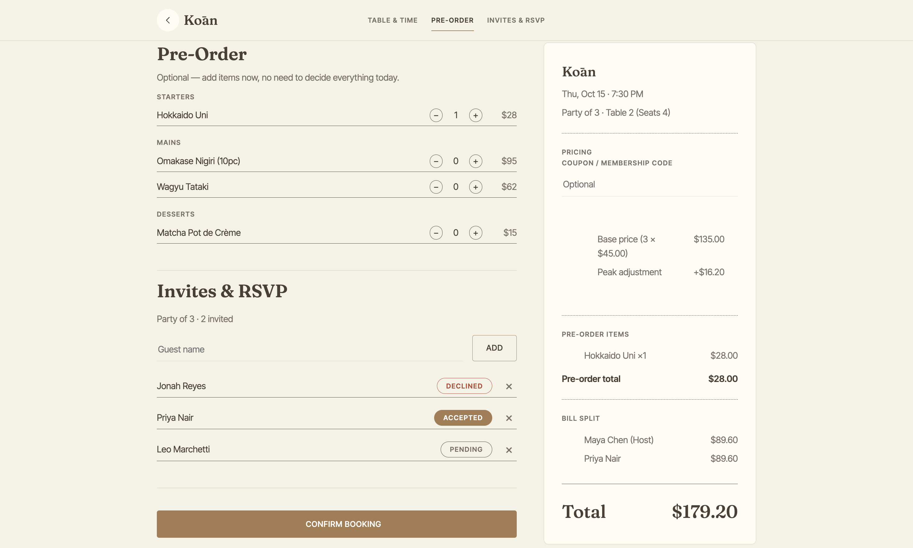

# DineWise

Restaurant reservation web app built with plain HTML, CSS, and JavaScript. No frameworks, no backend.

**Stack:** HTML5, CSS3, JavaScript (ES6+), localStorage

## What it does

- Recommends restaurants based on a guest's favorite cuisines, diet, and allergies
- Lets guests pick a table by clicking on a photo of the restaurant floor
- Prevents double-booking by locking reserved tables
- Adjusts prices for peak hours and applies coupon and loyalty discounts
- Supports group bookings with RSVP tracking and bill splitting
- Adds guests to a waitlist when a time slot is full
- Shows reservations with QR codes on a personal dashboard

## How it's built

- Single-page app with 11 JavaScript modules, each handling one job (pricing, recommendations, storage, UI, etc.)
- Pricing logic is kept separate from the UI and runs in a fixed order: base price, peak adjustment, discounts, total, split
- Data is saved in localStorage using versioned keys so the format can change later
- QR codes are generated from each reservation ID, so nothing extra needs to be stored
- Styling uses a shared set of CSS variables for colors, fonts, and spacing

